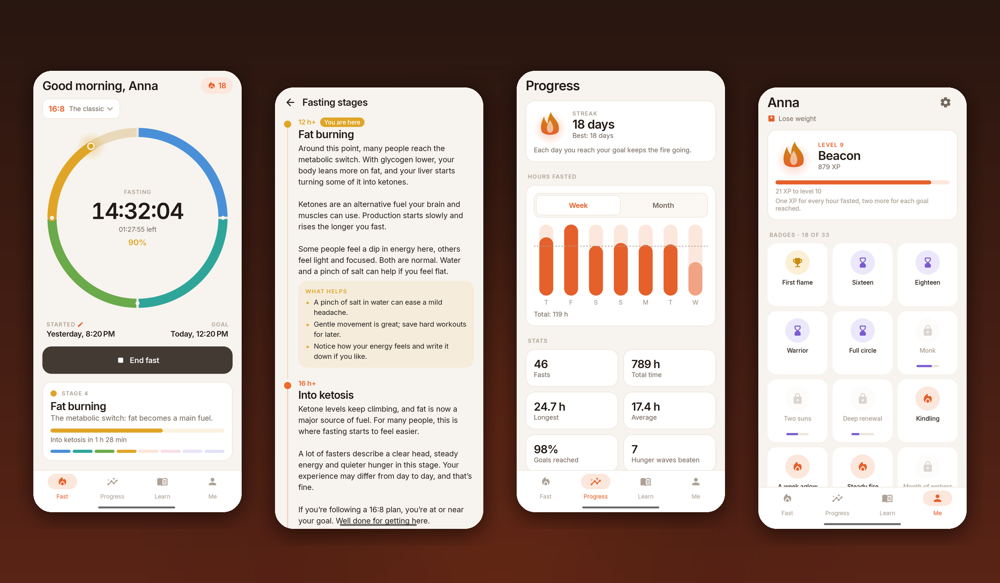
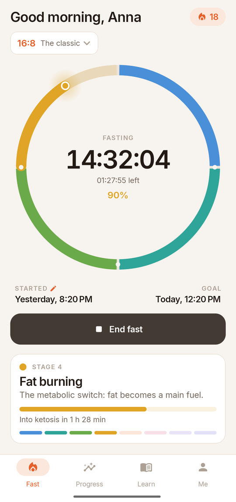
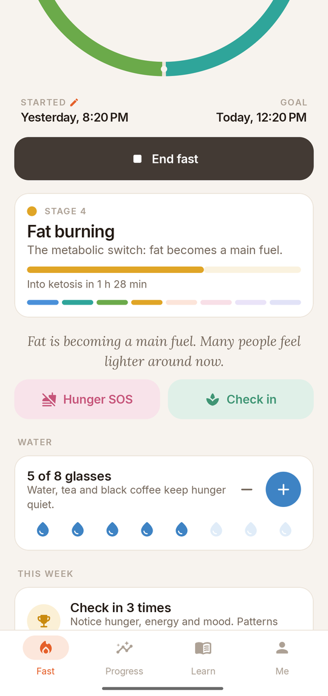
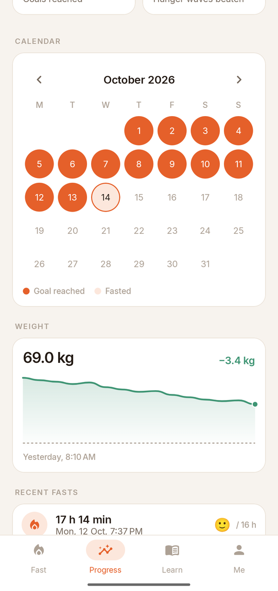
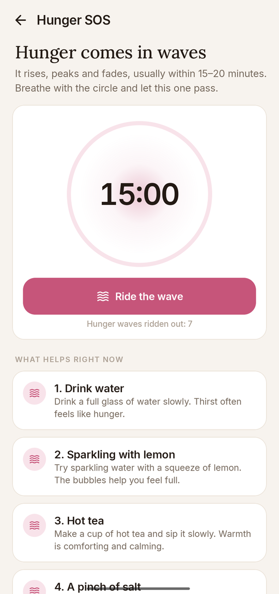
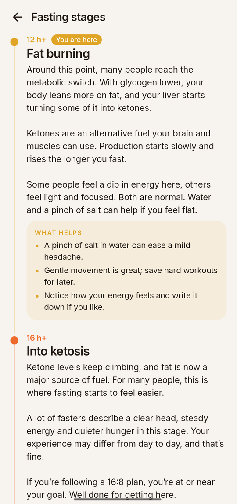
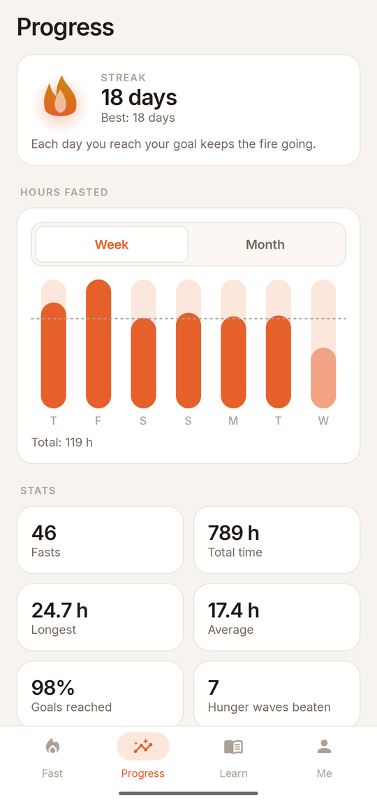
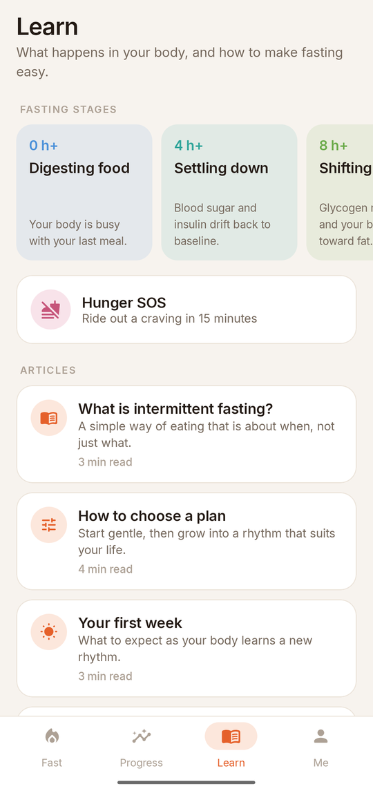
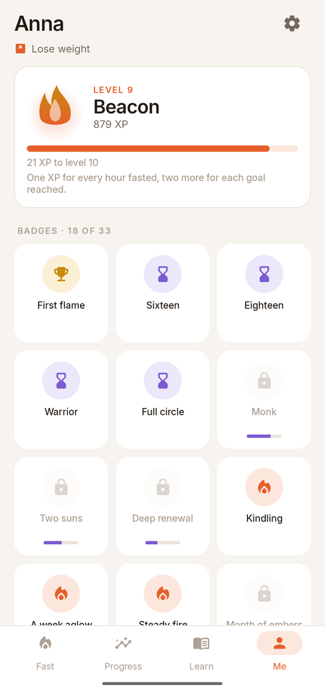

<div align="center">


# Ember

### Intermittent fasting, made warm and simple

*A fasting timer that explains what your body is doing, with streaks, levels, badges, weekly challenges and a Hunger SOS for the hard moments. Free, no ads, no premium, no account, works offline.*

[](https://github.com/bigdevwhale/ember/actions/workflows/android.yml)
[](https://github.com/bigdevwhale/ember/releases/latest)


[](LICENSE)

**English** · [Русский](README.ru.md) · [Website](https://bigdevwhale.github.io/stillcraft/apps/ember/) · [Changelog](CHANGELOG.md)



</div>

---

## The idea

Fasting is simple: don't eat for a while. Doing it day after day is the hard part.

Ember makes the hours feel like they mean something. It shows what is happening in your body as the clock runs, cheers you on when the goal is reached, and is there when hunger knocks. Most fasting apps lock their best parts behind a subscription. Here everything is free, nothing needs an account, and nothing leaves your phone.

## What's inside

| | Feature | How it works |
|---|---|---|
| ⏱️ | **A timer that explains** | The ring is split into eight coloured stages: digestion, blood sugar settling, the fuel switch, fat burning, ketosis, autophagy, the growth-hormone rise and deep renewal. You see the stage you are in, the time to the next one, and a short note for every hour. |
| 🗓️ | **Plans for every level** | 12:12, 14:10, 16:8, 18:6, 20:4, one meal a day, 24, 36, 48 and 72 hours, or your own length. Set when the daily fast begins and Ember shows your eating window. |
| 🔥 | **Streaks and levels** | Every day you reach your goal keeps the fire going. Levels grow with the hours you fast, from *Spark* to *Sun*. |
| 🏅 | **33 badges and weekly challenges** | Badges for long fasts, streaks, total hours, weight, water and more. A new challenge arrives every Monday: five good days, an early dinner, a longer fast… |
| 🌊 | **Hunger SOS** | Hunger comes in waves and passes in 15–20 minutes. Breathe with the circle and ride it out, with ten quick things that help. |
| 📈 | **Progress** | Hours fasted per week or month, a calendar of reached goals, stats, and the full history. You can edit any fast or add one you forgot. |
| ⚖️ | **Weight, water and check-ins** | A weight chart with goal and BMI, a water counter, and quick check-ins for hunger, energy and mood. |
| 📚 | **Learn** | 18 short, honest articles: what breaks a fast, electrolytes, breaking a fast well, exercise, sleep, fasting for women, longer fasts and safety. |
| 🔔 | **Notifications and widget** | A quiet live timer in the notification shade, alerts for the goal and new stages, a nudge at the scheduled start with a *Start now* button, and a home-screen widget. |

<table>
  <tr>
    <td></td>
    <td></td>
    <td></td>
    <td></td>
  </tr>
  <tr>
    <td></td>
    <td></td>
    <td></td>
    <td></td>
  </tr>
</table>

## Safety first

Fasting isn't for everyone. Talk to a doctor before fasting if you are pregnant or breastfeeding, under 18, have had an eating disorder, have diabetes or take medication that lowers blood sugar, or live with a chronic condition. Stop a fast whenever you feel faint or unwell. Ember shares general information and is not medical advice.

## English & Русский

Every screen and every article is written natively in both languages. The Russian texts are gender-neutral. Switch in **Me → Settings → Language**. On Android 13+ the app also appears in the system's per-app language settings.

## Download

Get the APK from **[Releases](https://github.com/bigdevwhale/ember/releases/latest)**, or the debug APK attached to any [CI run](https://github.com/bigdevwhale/ember/actions/workflows/android.yml). Ember needs Android 8.0 (API 26) or newer.

> [!TIP]
> On Xiaomi (MIUI / HyperOS), Huawei and some other phones, allow **Autostart** and remove battery limits so the timer notification and reminders arrive on time.

## Privacy

Ember has no accounts, no servers, no analytics, no ads and no internet permission. Fasts, weight, water and check-ins live in a local database on the phone. **Settings → Backup** exports everything to a JSON file you keep.

## Under the hood

- **Kotlin + Jetpack Compose**, Material 3 with a custom palette, the Inter and Lora typefaces.
- The fasting ring, charts, flame and confetti are drawn on a `Canvas`.
- **Room** stores fasts, weight, water and check-ins; **DataStore** holds the settings.
- **AlarmManager** handles goal, stage and schedule alerts. The ongoing notification and the widget use a system chronometer, so they tick without waking the app.
- Streaks, levels, badges and weekly challenges are pure functions of the history (`domain/`), covered by unit tests.

```
app/src/main/java/app/ember/
├── content/     stages, articles, tips, hour notes, hunger tips (EN + RU)
├── data/        Room database, settings, JSON backup, demo seed
├── domain/      plans, stages, stats & streaks, levels, badges, challenges
├── notify/      alarms, ongoing timer notification, boot receiver
├── widget/      home-screen widget
└── ui/          fast, progress, learn, me, onboarding, settings
```

Build it with `./gradlew assembleDebug`. `./gradlew installDebug -Pdemo` installs `app.ember.demo` with a made-up history, the one used for these screenshots.

## License

[MIT](LICENSE). Part of [Stillcraft](https://bigdevwhale.github.io/stillcraft/), small tools for a quieter mind.
