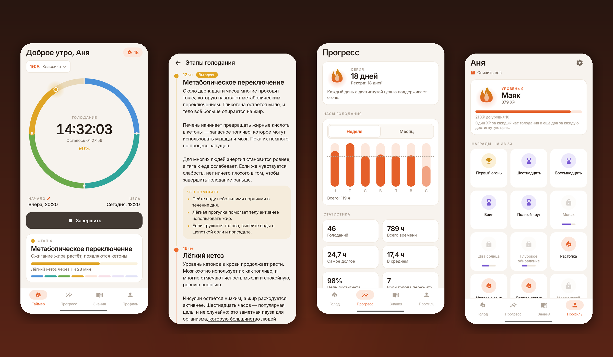
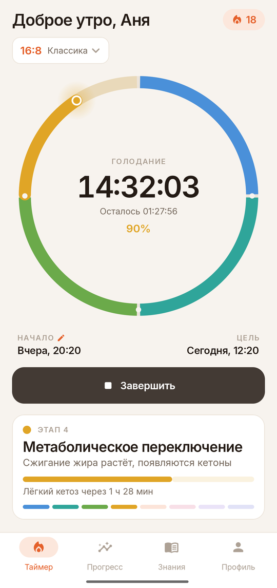
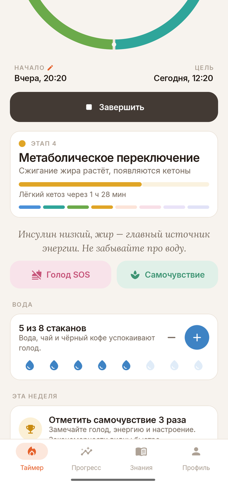
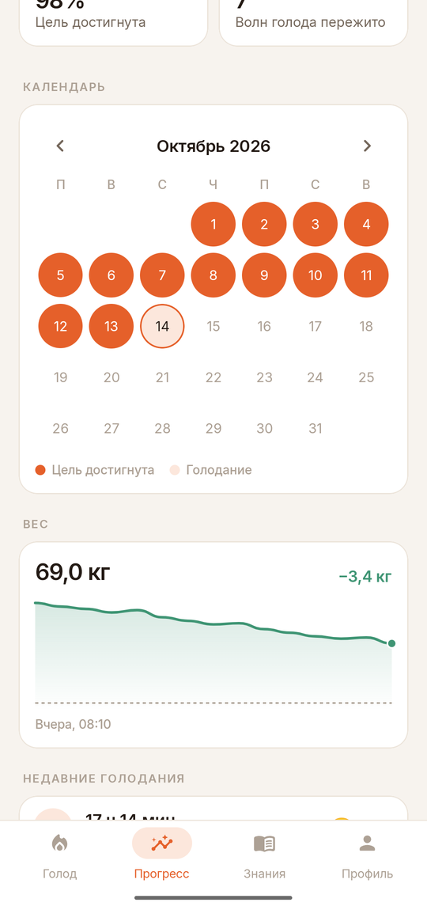
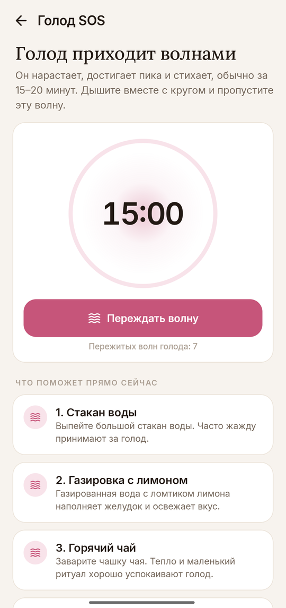
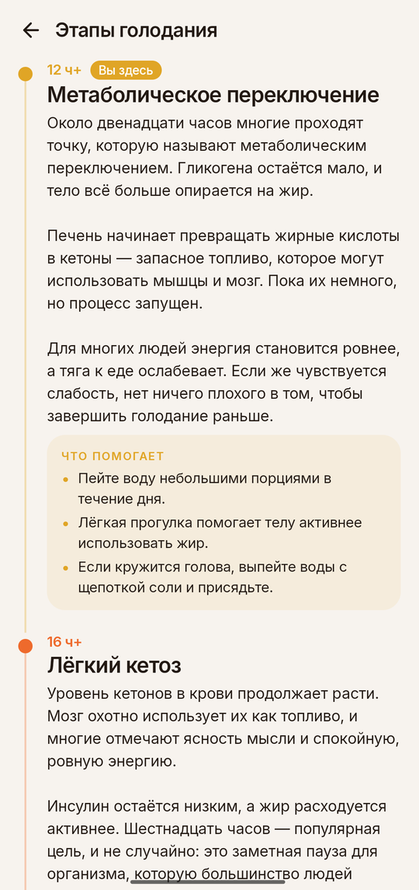
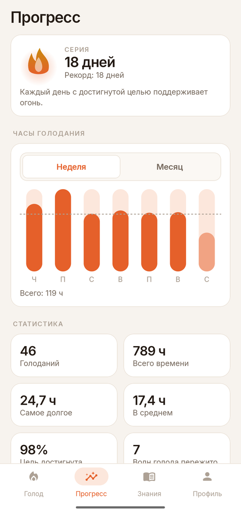
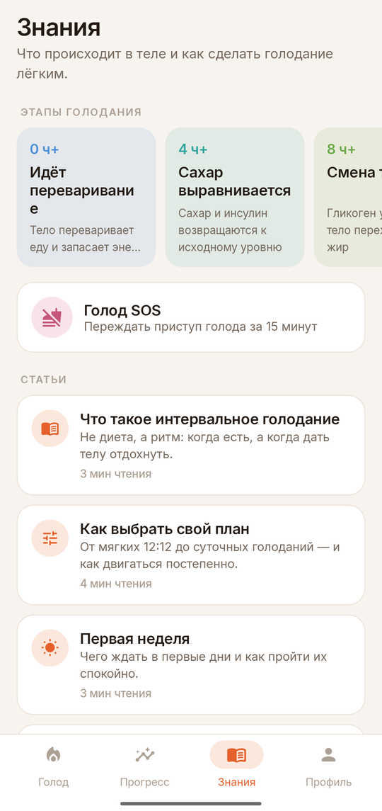
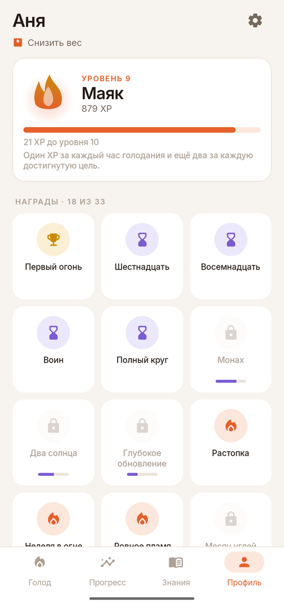

# Ember

### Интервальное голодание — тепло и просто

*Таймер голодания, который объясняет, что происходит в теле. Серии, уровни, награды, испытания недели и «Голод SOS» для трудных минут. Бесплатно, без рекламы, премиума и аккаунта, работает офлайн.*

[English](README.md) · **Русский** · [Сайт](https://bigdevwhale.github.io/stillcraft/apps/ember/) · [История изменений](CHANGELOG.md)

---

## Идея

Голодать просто: какое-то время не есть. Сложно делать это день за днём.

Ember наполняет часы смыслом. Пока идёт таймер, видно, что происходит в теле. Когда цель достигнута, приложение радуется вместе с вами, а когда подступает голод, помогает его переждать. Большинство приложений для голодания прячут лучшее за подпиской. Здесь всё бесплатно, аккаунт не нужен, и ничего не покидает телефон.

## Что внутри

| | Возможность | Как это работает |
|---|---|---|
| ⏱️ | **Таймер, который объясняет** | Кольцо разделено на восемь цветных этапов: переваривание, сахар приходит в норму, смена топлива, жиросжигание, кетоз, аутофагия, подъём гормона роста и глубокое обновление. Видно текущий этап, время до следующего и короткую заметку на каждый час. |
| 🗓️ | **Планы для любого уровня** | 12:12, 14:10, 16:8, 18:6, 20:4, раз в день, 24, 36, 48 и 72 часа или своя длительность. Укажите, когда начинается голодание, и Ember покажет окно питания. |
| 🔥 | **Серии и уровни** | Каждый день с достигнутой целью поддерживает огонь. Уровни растут с часами голодания: от *Искры* до *Солнца*. |
| 🏅 | **33 награды и испытания недели** | Награды за долгие голодания, серии, общее время, вес, воду и не только. Каждый понедельник новое испытание: пять хороших дней, ранний ужин, голодание подольше… |
| 🌊 | **Голод SOS** | Голод приходит волнами и проходит за 15–20 минут. Дышите вместе с кругом и переждите волну, а рядом десять быстрых способов себе помочь. |
| 📈 | **Прогресс** | Часы голодания за неделю или месяц, календарь достигнутых целей, статистика и вся история. Любое голодание можно поправить или добавить забытое. |
| ⚖️ | **Вес, вода и самочувствие** | График веса с целью и ИМТ, счётчик воды и быстрые отметки голода, энергии и настроения. |
| 📚 | **Знания** | 18 коротких честных статей: что прерывает голодание, электролиты, как правильно выходить из голодания, спорт, сон, голодание для женщин, долгие голодания и безопасность. |
| 🔔 | **Уведомления и виджет** | Тихий живой таймер в шторке, сообщения о цели и новых этапах, напоминание по расписанию с кнопкой *Начать сейчас* и виджет на главный экран. |

<table>
  <tr>
    <td></td>
    <td></td>
    <td></td>
    <td></td>
  </tr>
  <tr>
    <td></td>
    <td></td>
    <td></td>
    <td></td>
  </tr>
</table>

## Сначала безопасность

Голодание подходит не всем. Посоветуйтесь с врачом, если вы беременны или кормите грудью, вам меньше 18 лет, было расстройство пищевого поведения, есть диабет или вы принимаете препараты, снижающие сахар, или есть хроническое заболевание. Прекращайте голодание при слабости или плохом самочувствии. Ember делится общей информацией и не заменяет врача.

## English и русский

Каждый экран и каждая статья написаны на обоих языках, а не переведены машиной. Русские тексты гендерно-нейтральны. Язык переключается в **Профиль → Настройки → Язык**. На Android 13+ приложение также есть в системных настройках языка приложений.

## Скачать

APK лежит в **[Releases](https://github.com/bigdevwhale/ember/releases/latest)**. Отладочный APK прикреплён к каждому [запуску CI](https://github.com/bigdevwhale/ember/actions/workflows/android.yml). Нужен Android 8.0 (API 26) или новее.

> [!TIP]
> На Xiaomi (MIUI / HyperOS), Huawei и некоторых других телефонах разрешите **Автозапуск** и снимите ограничения батареи, чтобы таймер в шторке и напоминания приходили вовремя.

## Приватность

Нет аккаунтов, серверов, аналитики, рекламы и разрешения на интернет. Голодания, вес, вода и самочувствие хранятся в локальной базе на телефоне. **Настройки → Резервная копия** выгружает всё в JSON-файл, который остаётся у вас.

## Как устроено

- **Kotlin + Jetpack Compose**, Material 3 с собственной палитрой, шрифты Inter и Lora.
- Кольцо голодания, графики, пламя и конфетти нарисованы на `Canvas`.
- **Room** хранит голодания, вес, воду и самочувствие, **DataStore** хранит настройки.
- **AlarmManager** отвечает за сообщения о цели, этапах и расписании. Уведомление в шторке и виджет используют системный хронометр и тикают, не будя приложение.
- Серии, уровни, награды и испытания считаются чистыми функциями по истории (`domain/`) и покрыты юнит-тестами.

Сборка: `./gradlew assembleDebug`. Команда `./gradlew installDebug -Pdemo` ставит `app.ember.demo` с выдуманной историей, по которой сделаны эти скриншоты.

## Лицензия

[MIT](LICENSE). Часть [Stillcraft](https://bigdevwhale.github.io/stillcraft/): небольших инструментов для спокойного ума.
